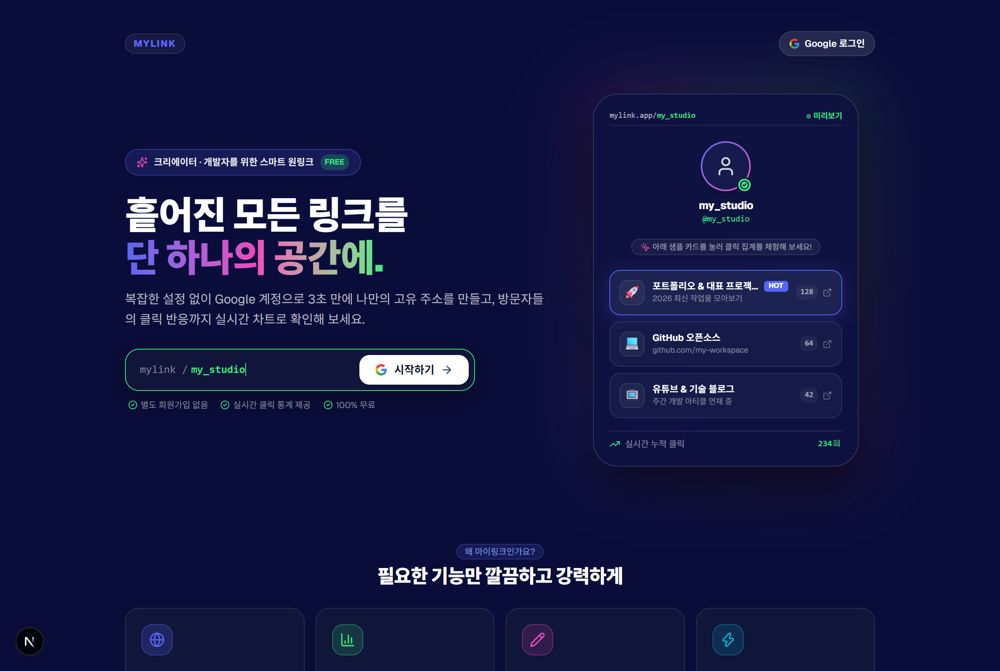
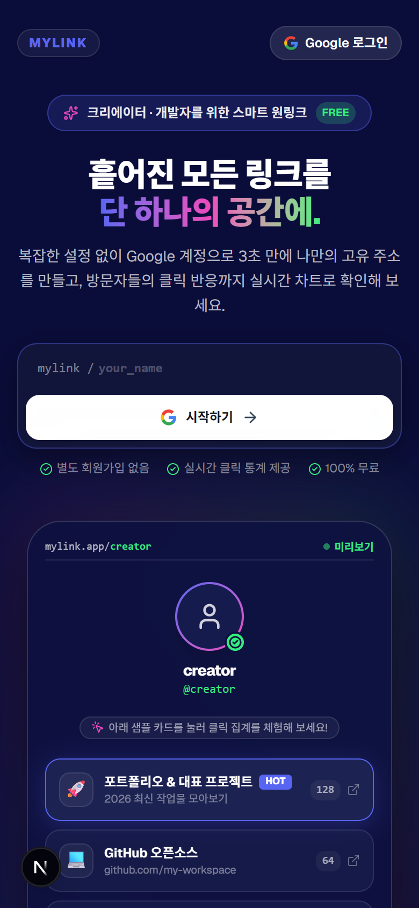
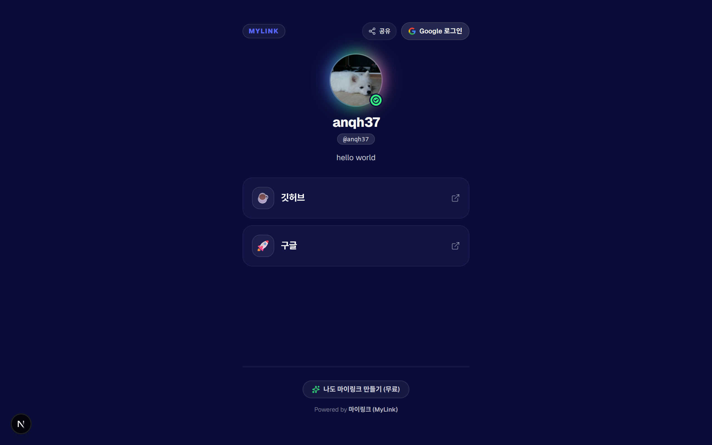
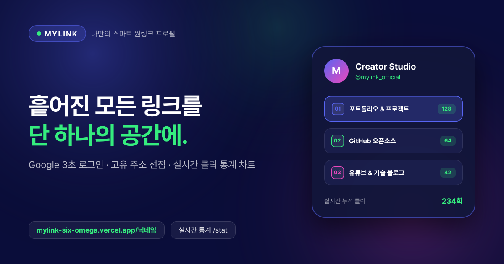
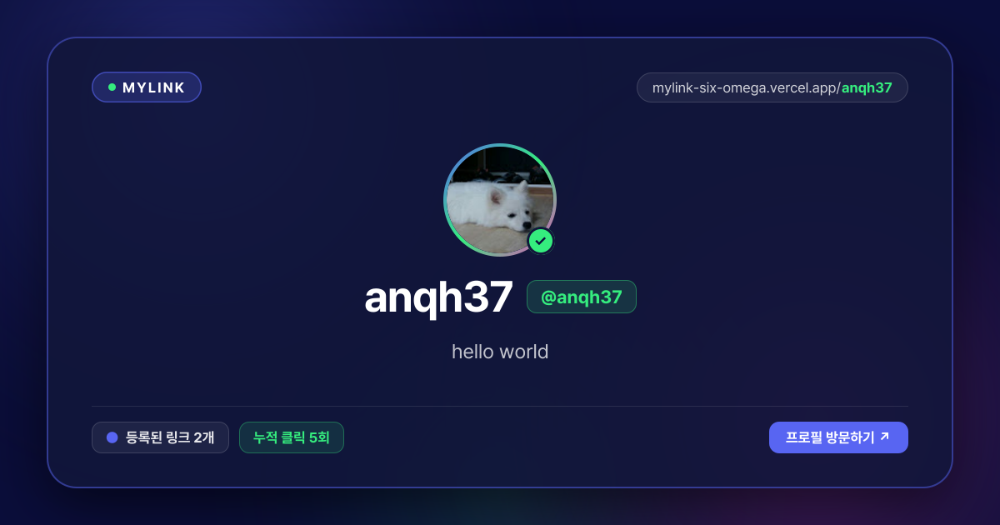

# 🔗 마이링크 (MyLink)

> **흩어진 모든 링크를 단 하나의 공간에.**  
> Google 계정 3초 로그인으로 나만의 고유 URL(`/[displayName]`)을 생성하고, 실시간 클릭 통계 차트(`/stat`)까지 확인할 수 있는 스마트 멀티 링크 서비스입니다.

🌐 **Live Demo**: [https://mylink-six-omega.vercel.app/](https://mylink-six-omega.vercel.app/)

---

## ✨ 주요 기능

- **🎨 반응형 · 인터랙티브 랜딩 페이지 (`/`)**
  - 비로그인 방문자를 위한 2단 반응형 랜딩 UI 및 실시간 닉네임 입력 · 클릭 집계 체험 목업 제공
- **🔐 Google 원클릭 로그인 & 개인화 저장소**
  - 별도 회원가입 없이 Google 로그인만으로 개인 전용 Firestore 컬렉션(`users/{uid}/links`) 자동 생성
  - 전역 Auth 리스너를 통해 모든 경로에서 일관된 인증 상태 유지
- **🌐 고유 닉네임 선점 & 공개 프로필 (`/[displayName]`)**
  - Firestore 트랜잭션 기반 `displayNames` 컬렉션으로 대소문자 구분 없는 100% 고유 닉네임 보장
  - 프로필 수정 다이얼로그에서 실시간 닉네임 중복 검사 및 낙관적 업데이트(Optimistic UI) 지원
- **⚡ 서버 기반 원자적 클릭 집계 (`POST /api/links/click`)**
  - 방문자가 링크를 클릭할 때 `navigator.sendBeacon` / `fetch(..., { keepalive: true })`로 요청을 전송하고, Firestore `increment(1)`로 동시성 이슈 없이 카운트 증가
- **📊 전용 통계 대시보드 (`/stat`)**
  - **shadcn/ui Chart (`recharts`)** 기반 링크별 클릭 비교 Bar Chart 및 점유율 Donut Chart
  - 총 클릭 수, 등록 링크 수, 최고 인기 링크, 평균 클릭 수 KPI 카드 및 순위별 상세 테이블 제공
- **🖼️ 파일 기반 동적 Open Graph & SEO 최적화**
  - 일반 경로용(`/opengraph-image`)과 동적 프로필용(`/[displayName]/opengraph-image`) PNG 자동 생성
  - 로컬 `Pretendard` 서브셋 폰트 번들링으로 외부 네트워크 의존성 없이 모든 환경에서 선명한 한글 OG 이미지 렌더링
  - 페이지별 `generateMetadata`, `canonical`, `robots.ts` 적용

---

## 📸 스크린샷

### 1. 반응형 랜딩 페이지 (Desktop & Mobile)

| Desktop (`1280×860`) | Mobile (`390×844`) |
| :---: | :---: |
|  |  |

### 2. 공개 프로필 페이지 (`/[displayName]`)



### 3. 동적 Open Graph 이미지 (`opengraph-image.tsx`)

| 일반 경로 (`/`, `/stat`) | 동적 프로필 경로 (`/[displayName]`) |
| :---: | :---: |
|  |  |

---

## 🛠️ 기술 스택

- **Framework**: Next.js 16 (App Router, Turbopack), React 19, TypeScript 5
- **Styling & UI**: Tailwind CSS v4, shadcn/ui (`@base-ui/react`), Lucide React, Sonner
- **Data Visualization**: shadcn/ui Chart, Recharts
- **State & Data Fetching**: Zustand, TanStack React Query v5, React Hook Form + Zod
- **Backend & Database**: Firebase v11 (Google Authentication, Cloud Firestore, Analytics)
- **Deployment**: Vercel

---

## 📁 프로젝트 구조

```text
mylink/
├── docs/
│   └── screenshots/                # README용 스크린샷 이미지
├── public/                         # 정적 에셋 및 검색엔진 소유 확인 파일
├── src/
│   ├── app/
│   │   ├── [displayName]/
│   │   │   ├── page.tsx            # 동적 공개 프로필 페이지 & 메타데이터
│   │   │   ├── not-found.tsx       # 존재하지 않는 프로필 404 안내
│   │   │   └── opengraph-image.tsx # 동적 프로필 전용 OG 이미지 생성기
│   │   ├── api/
│   │   │   ├── links/click/route.ts# 원자적 클릭 카운트(+1) API
│   │   │   └── profile/route.ts    # 프로필 API
│   │   ├── stat/
│   │   │   ├── layout.tsx          # 통계 페이지 SEO 메타데이터
│   │   │   └── page.tsx            # shadcn Chart 기반 통계 대시보드
│   │   ├── layout.tsx              # 루트 레이아웃 & 동적 metadataBase
│   │   ├── page.tsx                # 메인 랜딩 / 로그인 링크 관리 홈
│   │   ├── opengraph-image.tsx     # 일반 경로용 OG 이미지 생성기
│   │   └── robots.ts               # 검색엔진 크롤러 규칙 (/robots.txt)
│   ├── assets/fonts/               # OG 이미지 렌더링용 로컬 Pretendard 폰트
│   ├── components/
│   │   ├── auth/                   # GoogleAuthButton (프로필 드롭다운 포함)
│   │   ├── landing/                # 반응형 인터랙티브 랜딩 페이지
│   │   ├── links/                  # 링크 카드, 추가/수정/삭제 컴포넌트
│   │   ├── navigation/             # MyPageButton
│   │   ├── profile/                # ProfileHeader, PublicProfileView, EditProfileDialog
│   │   ├── providers/              # QueryProvider (전역 Auth 리스너 포함)
│   │   ├── stats/                  # 홈 화면 요약 통계 섹션
│   │   └── ui/                     # shadcn/ui 컴포넌트 (chart, button, card 등)
│   ├── hooks/                      # TanStack Query 커스텀 훅
│   ├── lib/                        # Firebase, Firestore, OG 폰트, 사이트 설정 유틸
│   ├── store/                      # Zustand 스토어 (useAuthStore, useProfileStore)
│   └── types/                      # TypeScript 타입 정의
├── firestore.rules                 # Cloud Firestore 보안 규칙
└── package.json
```

---

## 🚀 로컬 실행 방법

### 1. 저장소 클론 및 패키지 설치

```bash
git clone https://github.com/overgrown37/mylink.git
cd mylink
npm install
```

### 2. 환경 변수 설정

`.env.example`을 참고하여 루트 디렉터리에 `.env.local` 파일을 생성합니다.

```env
NEXT_PUBLIC_FIREBASE_API_KEY=your_firebase_api_key
NEXT_PUBLIC_FIREBASE_AUTH_DOMAIN=your_project.firebaseapp.com
NEXT_PUBLIC_FIREBASE_PROJECT_ID=your_project_id
NEXT_PUBLIC_FIREBASE_STORAGE_BUCKET=your_project.firebasestorage.app
NEXT_PUBLIC_FIREBASE_MESSAGING_SENDER_ID=your_messaging_sender_id
NEXT_PUBLIC_FIREBASE_APP_ID=your_app_id
NEXT_PUBLIC_FIREBASE_MEASUREMENT_ID=your_measurement_id
```

### 3. 개발 서버 실행 및 빌드

```bash
# 개발 서버 실행 (http://localhost:3000)
npm run dev

# 프로덕션 빌드 및 실행
npm run build
npm run start

# 린트 검사
npm run lint
```
